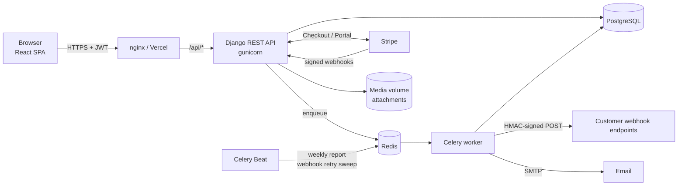
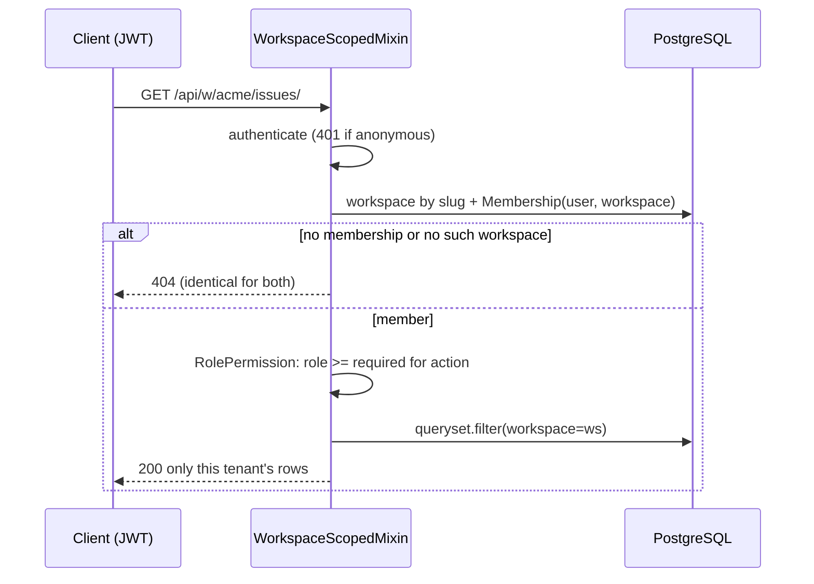
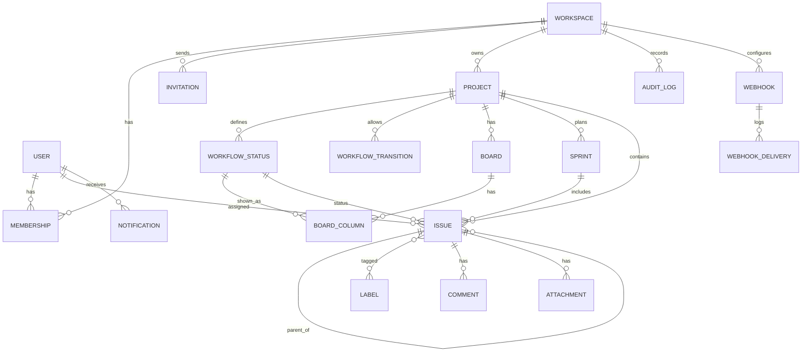
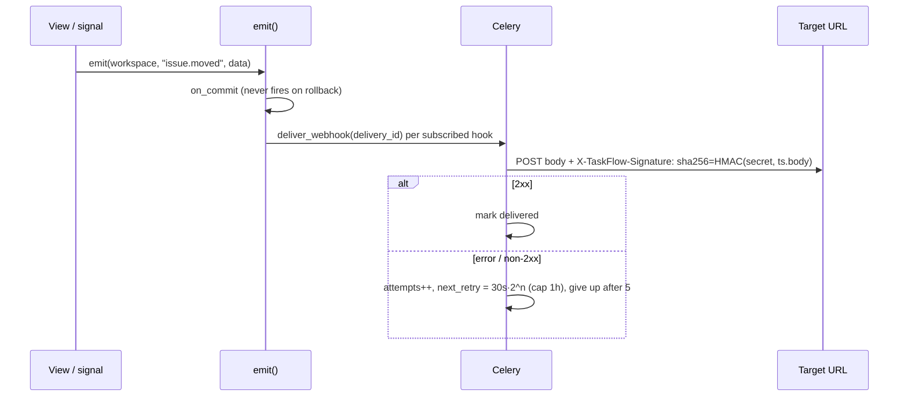
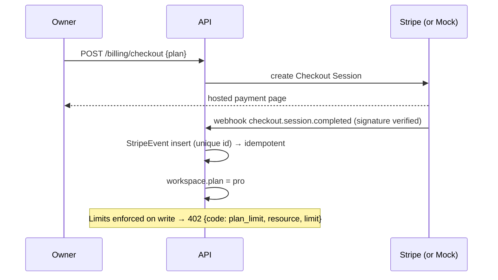

# Architecture

## 1. System overview

Production topology used for the demo: **Vercel** (static frontend) → **Render** (API + Postgres). On Render's free tier there is no worker dyno, so Celery runs in eager mode (`CELERY_EAGER=1`); adding a worker and Redis is configuration only.

## 2. Tenant isolation (shared schema, `workspace_id` everywhere)

Every request to tenant data goes through `/api/w/{workspace_slug}/…`. Three independent layers:

1. **Model layer** – `TenantModel` gives every tenant table a non-null `workspace` FK.
2. **View layer** – `WorkspaceScopedMixin` resolves the workspace from the URL, verifies membership, filters every queryset, and sets the acting user for the audit log. `TenantPrimaryKeyRelatedField` / `WorkspaceMemberField` stop clients attaching another tenant's project, sprint, label, parent or assignee by guessing IDs.
3. **Test layer** – 14 cross-tenant tests (`tests/test_tenant_isolation.py`) attack every list endpoint, foreign IDs in URLs and request bodies, attachment downloads, search, dashboard and audit data.

## 3. Roles

| Capability | Viewer | Member | Admin | Owner |
|---|:-:|:-:|:-:|:-:|
| Read everything in the workspace | ✓ | ✓ | ✓ | ✓ |
| Create/edit issues, comment, attach, move on board | | ✓ | ✓ | ✓ |
| Delete issues; create projects, sprints, statuses/workflows | | | ✓ | ✓ |
| Invite/remove members, webhooks, audit log, start/close sprints | | | ✓ | ✓ |
| Billing, change ownership, delete workspace | | | | ✓ |

Roles are per workspace (a user can be Owner in one and Viewer in another).

## 4. Data model

Key design choices:
- **Issue numbering**: `Project.issue_counter` incremented under `SELECT … FOR UPDATE` → gap-free `WEB-1, WEB-2…`. A threaded test (`test_concurrency.py`) proves uniqueness under contention; it runs in CI on PostgreSQL.
- **Drag-and-drop ordering**: `Issue.rank` is a float. Dropping between two cards sets the midpoint, so a move updates **one row**. If neighbours get closer than 1e-6 the column is rebalanced once. Tested.
- **Workflows**: with no transitions defined a project is *open* (any move allowed); once any exist, only listed moves are allowed. Enforced in the API for both PATCH and the board `move` action, and mirrored in the UI.
- **Audit log**: Django signals capture create/update/delete with a field-level diff and the acting user (a request-scoped `contextvar`). FKs are stored as readable values (`"status": {"old": "To Do", "new": "Done"}`).

## 4b. Request/event flows

**Webhook delivery**

**Billing**

## 5. API surface

Auto-generated OpenAPI/Swagger at `/api/docs/` (schema at `/api/schema/`). Main groups under `/api/w/{slug}/`: `projects`, `issues` (+`move`, `history`, `transitions`), `sprints` (+`start`, `close`, `burndown`), `statuses`, `transitions`, `columns`, `labels`, `comments`, `attachments`, `saved-filters`, `members`, `invitations`, `audit-log`, `webhooks`, `webhook-deliveries`, `notifications`, `dashboard`, `search`, `reports/weekly`, `billing/*`. Public: `auth/*`, `invitations/{token}`, `billing/stripe-webhook`.

## 6. Security notes

- JWT auth; auth endpoints rate-limited. Production refuses to boot with the default `SECRET_KEY`.
- Passwords validated and hashed by Django; emails normalised to lower-case.
- Attachments are never served from a public `/media` URL; downloads require membership, add `nosniff`, and executable extensions are rejected.
- Webhook targets are checked against private/loopback/link-local ranges (SSRF) and redirects are not followed.
- Stripe webhooks require a valid signature in production; unsigned events are rejected.
- Secure cookies, clickjacking header and proxy-SSL settings are on when `DEBUG=0`; HSTS and SSL redirect are env-controlled.
